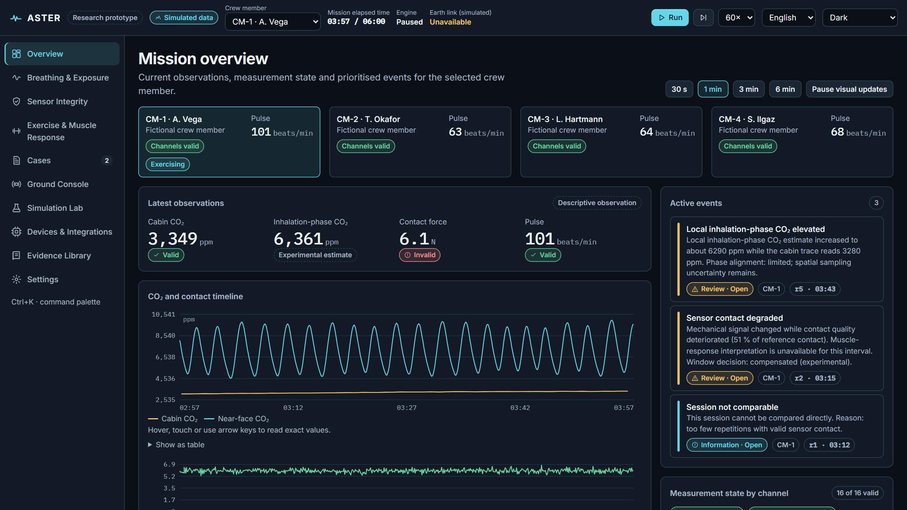

# ASTER — Space Health Research Console

**Research prototype · simulated data.** ASTER is an offline-capable web application that connects breathing exposure, sensor reliability and exercise response in one evidence-linked workflow. It is built around one question: *what changed, how trustworthy is the measurement, and what evidence supports the next step?*

> Not a medical device. Not clinically validated, not flight-qualified, not endorsed by NASA or any agency. All physiological signals are synthetic and crew names are fictional. "ASTER" is a provisional working name.



## What works in this release

| Area | Status |
|---|---|
| **Breathing & Exposure** | Breath detection, four estimation methods (three baselines + candidate), per-breath inspection, withheld estimates with reasons, export |
| **Sensor Integrity** | Contact/calibration gating with lifecycle, three processing methods, sensor map, simulated calibration |
| **Exercise & Muscle Response** | Repetition detection, matched-reference comparison, impedance context, generated-history reference sessions |
| **Cases** | Versioned rule cards, dwell/reset state machines, monotonic revisions, acknowledgement, JSON export and print/PDF |
| **Ground Console** | Store-and-forward over a simulated delayed link, durable outbox, retry, deduplication, revision-linked replies, stale-context flag |
| **Simulation Lab** | 15 seeded scenarios, run/pause/step, 1×/10×/60×, fault injection, read-only historical inspection, fork and reset as new runs, researcher-only hidden-truth evaluation |
| **Devices & Integrations** | CSV/NDJSON replay import, local WebSocket telemetry, serial reference frame parser, opt-in local camera preview — **emulator-verified only** |
| **Platform** | Offline PWA, light/dark/system themes, Motion-based animation with a reduced-motion mode, 7 locales (en, tr, de, fr, es, ar-RTL, ja), keyboard and screen-reader support |
| **Local workstation profile** | Gateway + separate ground process (Fastify, SQLite) exchanging packages over real HTTP, device emulator |

Three labels are kept separate everywhere: **source** (simulated / recorded / hardware / mixed), **measurement state** (valid / suspect / invalid / stale / unavailable) and **interpretation status** (observation / experimental estimate / research guidance).

## Quick start

Prerequisites: Node.js ≥ 24, pnpm 11, Google Chrome (for the browser tests).

```bash
pnpm install --frozen-lockfile
pnpm build
pnpm preview            # http://127.0.0.1:4173
```

Press **Start demo**, then **Run**. Use the speed selector (1× / 10× / 60×) in the top strip. `pnpm dev` starts the development server on port 5173.

## Scenario guide

| ID | Scenario | Expected behaviour |
|---|---|---|
| SIM-01 | Quiet nominal baseline | No review/priority event |
| SIM-02 | Local mixing change, stable cabin | Exposure event; no cabin alarm |
| SIM-03 | Exhalation spike only | No exposure event (naive baselines are fooled) |
| SIM-04 | Slow gas sensor, uncertain phase | Estimate withheld with a reason |
| SIM-05 | Garment contact slip | Integrity event; muscle comparison withheld |
| SIM-06 | Source change, contact stable | Change is **not** normalised away |
| SIM-07 | Calibration path mismatch | Correction rejected, data kept |
| SIM-08 | Same exercise, changed response | Bounded experimental deviation |
| SIM-09 | Different load | Comparison refused |
| SIM-10 | Impedance shift only | Context event, no muscle interpretation |
| SIM-11 | Combined (default demo) | Independent channels stay usable |
| SIM-12 | Link outage + duplicate receipt | Persist, retry, deduplicate |
| SIM-13 | Late reply to superseded revision | Stale context flagged |
| SIM-14 | Missing/malformed data | Quarantine, no fabricated continuity |
| SIM-15 | Storage failure | Visible persistence failure and recovery |

The same scenario and seed reproduce identical observations and events at any playback speed.

## Architecture

```
packages/contracts   zod schemas for everything that crosses a boundary (no truth type exists here)
packages/engine      quality → features → estimates → rule state machines   (imports contracts ONLY)
packages/simulator   seeded latent scenario → noisy observation model; truth routed separately
packages/comms       SHA-256, case packages, link simulator, durable sender, ground-station logic
packages/runtime     one deterministic mission execution on a virtual clock; replayable command log
packages/evaluation  joins engine output with hidden truth AFTER the run (never imported by engine/UI)
packages/adapters    CSV/NDJSON import, serial frame parser, WebSocket / Web Serial adapters
apps/web             React + Vite PWA; mission worker; IndexedDB (Dexie)
apps/gateway         local mission workstation (Fastify, WebSocket, SQLite), real HTTP transport
apps/ground          separate ground process with its own database
```

Import boundaries are enforced by `pnpm lint` and by unit tests.

## Execution profiles and offline behaviour

- **Browser demo** — a Web Worker owns the simulation and analysis; IndexedDB stores the run spec, command log, event revisions and outbox. After the first load the app, fonts and scenarios are cached; it reloads and runs with the network blocked (verified by an automated test). **Closing the tab or suspending the device stops computation** — this is not background monitoring. One tab owns the mission session; other tabs wait as viewers. Service-worker updates are never applied automatically during a run.
- **Local mission workstation** — the gateway owns the run at 1× wall time and keeps running while its process runs, even if the UI closes. Power loss or shutdown stops it; it recovers from its database on restart.

```bash
pnpm dev:ground          # ground process   http://127.0.0.1:4320
pnpm dev:mission         # gateway          http://127.0.0.1:4310
pnpm device:emulator     # reference device emulator → gateway WebSocket (add -- --corrupt to see CRC rejection)
```

Both servers bind to loopback and are **unauthenticated in loopback mode**. Any other interface requires `ASTER_API_TOKEN` (≥ 24 characters) and allow-lists; see `.env.example` and [docs/SECURITY.md](docs/SECURITY.md). There is no TLS — put a terminating proxy in front for anything beyond localhost.

"Earth communication" here is an application-level store-and-forward model. It is not radio infrastructure or a DTN stack, and nothing in it shortens propagation delay.

## Integration status

| Integration | Verification level |
|---|---|
| Built-in simulator | emulator-verified |
| CSV / NDJSON replay | emulator-verified (bundled synthetic recording) |
| Local WebSocket telemetry | emulator-verified |
| Serial reference frame (Web Serial) | emulator-verified parser; **no physical device tested** |
| Bluetooth LE | not implemented |
| Camera | local preview only; no pose or any inference implemented |

External telemetry is validated and counted; it is not merged into the simulated run.

## Verification and reproduction

```bash
pnpm lint            # architecture boundaries, security bans, locale parity
pnpm typecheck
pnpm test            # unit/integration (Vitest)
pnpm test:e2e        # browser tests against the production build (Chrome, Firefox, WebKit)
pnpm evaluate        # held-out evaluation → docs/VALIDATION_REPORT.md, deliverables/reports/
pnpm release:verify  # all of the above, in order
pnpm capture:product # real product stills + screen recording → deliverables/captures/
pnpm slides:build && pnpm slides:verify   # decks → PPTX, then PDF + thumbnails via local PowerPoint
pnpm report:build    # project report (EN + TR) → deliverables/report/
```

Current counts are recorded in `deliverables/reports/test-summary.json` (89 unit/integration tests and 9 browser tests run in each of Chrome, Firefox and WebKit, all passing at the time of writing). The Firefox and WebKit builds are Playwright's; Safari on macOS/iOS was not tested. First-time setup for the browser tests: `npx playwright install firefox webkit ffmpeg`.

## Results, with limitations

Held-out simulation, 20 seeds per scenario, varied sensor dynamics; full tables and negative results in [docs/VALIDATION_REPORT.md](docs/VALIDATION_REPORT.md).

- **Exposure:** candidate MAE 284 ± 175 ppm versus 1250 (phase-gated), 1259 (local mean) and 1192 (cabin); lowest error in 70 % of runs. With a slow sensor the estimate is withheld rather than reported.
- **Integrity:** during a coupling fault the released gate raised no false exercise-deviation event; it achieves this by rejecting data. Gain compensation recovers coverage but leaves a systematic error and stays experimental. Paired-reference cancellation did not help.
- **Exercise:** the matched method flags a real response change, abstains on a load mismatch and during a contact fault; a fluid shift alone still caused a false deviation event in 10 % of runs.

These numbers describe software and method behaviour in simulation. They are **not** clinical sensitivity. See [docs/CLAIM_LEDGER.md](docs/CLAIM_LEDGER.md).

## Accessibility and localisation

Target WCAG 2.2 AA. Automated axe checks pass on all 11 routes in both themes; navigation, charts (arrow keys) and dialogs are keyboard operable; every chart has a table alternative; status is never colour-only; reduced motion is honoured. UI strings exist for seven locales with enforced key and placeholder parity; Arabic mirrors the layout but not the time axis. Translations were machine-produced and have **not** been reviewed by native speakers. Rule definitions, source titles and documentation stay in English.

## Media

- Presentations: `deliverables/presentation/` — `ASTER_Product_Overview` and `ASTER_Short_Pitch` (English), `ASTER_Urun_Sunumu_TR` and `ASTER_Kisa_Sunum_TR` (Turkish); PPTX, PDF, thumbnails, speaker notes, asset manifest, QA report.
- Project report: `deliverables/report/` (English and Turkish PDF).
- Product captures and a raw, silent 1080p screen recording of the real app: `deliverables/captures/`.
- Video: `deliverables/video/ASTER_Product_Film_EN_1080p.mp4` — main film with English narration (103 s, 1080p). Product scenes are the real application; narration, music and one abstract insert were generated with Higgsfield. The audio has not been reviewed by ear; see `deliverables/video/README.md`.

## Known deviations from the build specification

Recorded in [docs/IMPLEMENTATION_DECISIONS.md](docs/IMPLEMENTATION_DECISIONS.md): single package with path aliases instead of a multi-package workspace; hand-written CSS tokens instead of Tailwind/shadcn; a custom SVG chart instead of ECharts; project lint instead of ESLint (no TypeScript 7 support yet); hash routing; only the main film was produced (no vertical cut or walkthrough). The React Bits / 21st.dev review is in [docs/UI_COMPONENT_PROVENANCE.md](docs/UI_COMPONENT_PROVENANCE.md). The original specification is preserved in [docs/specification/](docs/specification/).

## Licences and notices

No licence has been adopted for this project yet. Third-party packages keep their own licences ([docs/DEPENDENCIES.md](docs/DEPENDENCIES.md)). One component is adapted from React Bits (MIT + Commons Clause; licence text in `apps/web/src/components/reactbits/`). Fonts: Inter and IBM Plex Mono (SIL OFL 1.1), self-hosted via `@fontsource`. No NASA insignia, stock imagery or third-party artwork is used; NASA and other sources are cited as attribution, not endorsement.

## AI assistance disclosure

The software, tests, documentation, report and slide decks in this folder were produced with Claude Fable 5.2 (Claude Code) under the team's direction, working from the specification in `../nasaspaceapp/`. Cited research belongs to its authors.
