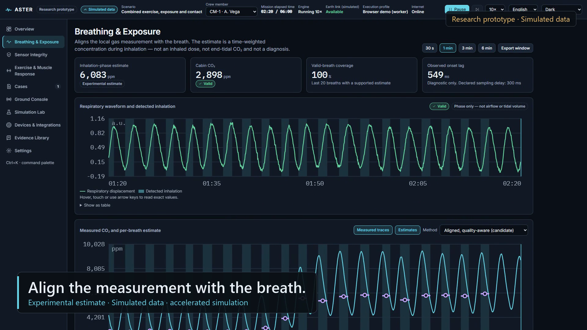

# ASTER product video

## Status: main film rendered; vertical cut and walkthrough not produced

| Item | File |
|---|---|
| Main film, English narration, 1920×1080, 30 fps, 103 s | `ASTER_Product_Film_EN_1080p.mp4` |
| Captions | `captions/ASTER_Product_Film_EN.srt`, `captions/ASTER_Product_Film_EN.vtt` |
| Poster frame | `poster-main.png` |
| Generated assets (voice, music, one insert) | `assets/` |
| Sources, hashes, models, job ids | `video-manifest.json` |

## How it was made

- **Product scenes are the real application.** They come from the screen recording and stills in `../captures/` (scenario SIM-11, seed 11; SIM-08 for the matched exercise view). The edit cuts, retimes and labels that footage; nothing in the interface is generated or repainted.
- **Generated with the Higgsfield connector** (free plan, 9.47 of 10 credits): the English narration (`qwen_audio_tts`, synthetic preset voice), an instrumental music bed (`elevenlabs_music_v2`) and one four-second abstract insert (`veo3_1_lite`, prompt A1 in `higgsfield-prompts.md`). The insert carries the on-screen label "Illustration · AI-generated footage, not the product".
- **Assembly** is scripted: `python scripts/video-build.py` (needs `pip install imageio-ffmpeg pillow`). Shot boundaries follow the pauses measured in the narration track.

## What has and has not been checked

- Checked: frames from every shot were inspected; duration, dimensions, frame rate and loudness were measured (−16.6 LUFS integrated, true peak −1.5 dBTP).
- **Not checked: nobody has listened to the film.** Pronunciation, pacing, the music balance and caption timing against the voice are unreviewed. Listen once before showing it.
- The narration makes no quantitative claim; on-screen numbers are the application's own simulated values.
- Higgsfield returned no licence or commercial-use terms for free-plan outputs. Confirm its terms before using the film outside this demonstration.

## Not produced

- Vertical social cut (≈ 35 s) and the 3–4 minute technical walkthrough; scripts are in `narration.md`, the plan in `shot-list.md`.
- Inserts A2, A3, B1 and C1: the cheaper video models are refused on the free plan and the remaining credits did not cover another clip. The "Body" and "Measurement" words therefore share the single insert.

## Rules that apply to any further cut

1. Primary scenes show the real application; generated footage is limited to the abstract inserts.
2. Keep "Research prototype · Simulated data" visible; label fast playback "accelerated simulation" and any wearable render "Hardware concept".
3. No NASA logo, testimonial, award badge, "clinically proven", "first" or "saves lives"; no number that is not in `docs/CLAIM_LEDGER.md`.
4. Voice must be clearly synthetic or a licensed recording; no imitation of an identifiable person.
